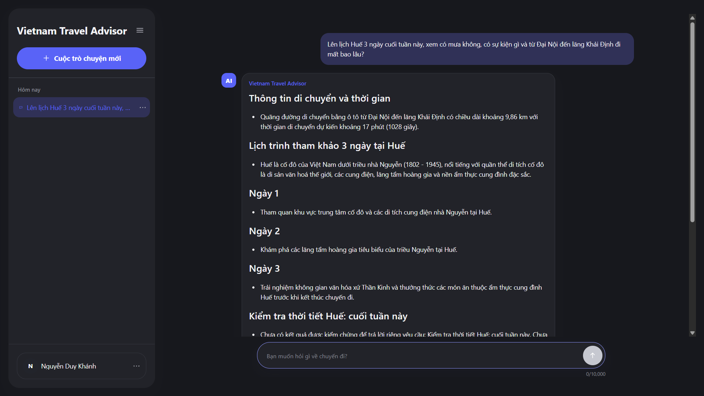
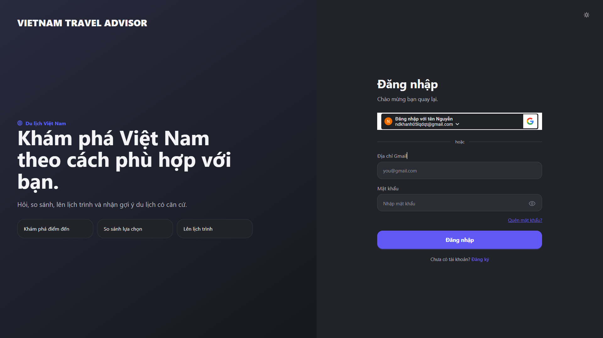
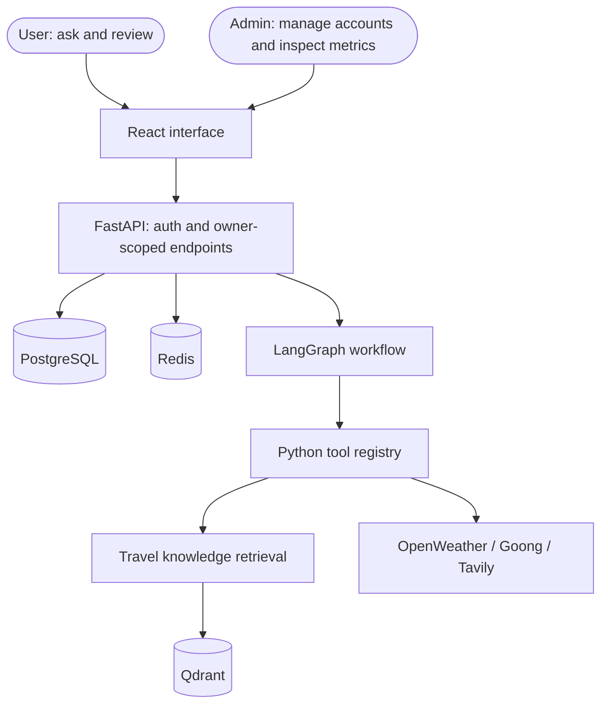
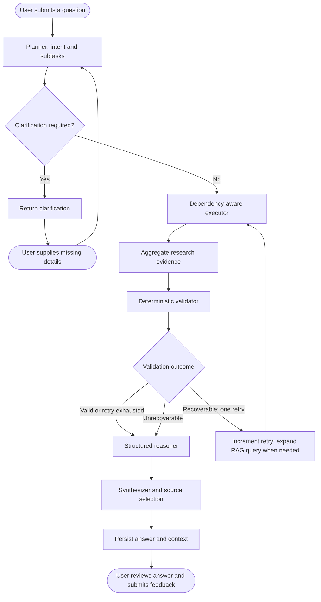
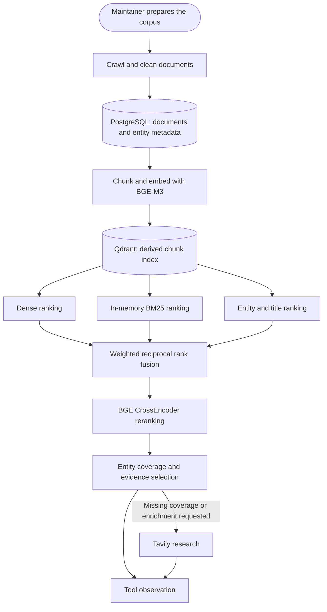

# Vietnam Travel Advisor

An agentic travel assistant for Vietnam that combines document retrieval,
live travel APIs, and conversation context to answer single-purpose and
compound questions. This personal project implements a React interface,
a FastAPI backend, and a bounded LangGraph workflow.

[](https://www.python.org/)
[](https://react.dev/)
[](https://www.typescriptlang.org/)
[](https://fastapi.tiangolo.com/)
[](https://github.com/langchain-ai/langgraph)
[](https://ai.google.dev/)
[](https://qdrant.tech/)
[](https://www.postgresql.org/)
[](https://redis.io/)
[](https://www.docker.com/)
[](https://github.com/features/actions)

## Live Demo

[Open live demo](https://vietnam-travel-advisor.duckdns.org)

<!-- Asset and link setup: see assets/README.md. -->

### Desktop Chat



<!-- Add one screenshot at assets/demo-desktop-chat.png, then replace the
screenshot placeholder with:


Suggested request:
"Lên lịch Huế 3 ngày cuối tuần này, xem có mưa không, có sự kiện gì và từ Đại Nội đến lăng Khải Định đi mất bao lâu?"

Capture the question, representative answer sections, and source references.
Hide personal information and unrelated conversation titles. Do not stage a
successful answer: retain any unavailable-data warning shown by the app. -->

<p align="center"><em>Figure 1. Desktop conversation illustrating a compound travel request and backend-provided source references.</em></p>

### Sign-in Screen



<!-- Add assets/demo-sign-in.png, then replace the placeholder above with:

Capture /login with both sign-in options, Forgot password, and Create account
visible. Use empty fields and hide saved email addresses or browser autofill.
See assets/README.md for setup instructions. -->

<p align="center"><em>Figure 2. Authentication interface with two sign-in methods and password recovery.</em></p>

## 1. Scope and Capabilities

The planner assigns a primary intent while decomposing additional requirements
into tool-specific subtasks. Intent labels are routing categories, not separate
autonomous agents. Budget calculation is not an implemented capability.

| Intent | Purpose | Example user request |
|---|---|---|
| `FACTUAL_TRAVEL` | Retrieve travel knowledge | “Đà Lạt có gì nổi bật?” |
| `RECOMMENDATION` | Suggest destinations or experiences | “Ở Huế buổi tối nên đi đâu?” |
| `COMPARISON` | Compare travel options | “Huế hay Hội An hợp đi 2 ngày hơn?” |
| `ITINERARY` | Organize a day-by-day trip | “Lên lịch trình Huế 3 ngày.” |
| `WEATHER` | Obtain weather observations or forecasts | “Huế cuối tuần có mưa không?” |
| `ROUTING` | Estimate routes, distance, and duration | “Từ Đại Nội đến lăng Khải Định bao xa?” |
| `CURRENT_INFO` | Search changing travel information | “Huế hiện có sự kiện gì?” |
| `GENERAL` | Handle conversational requests | “Bạn làm được gì?” |
| `OUT_OF_SCOPE` | Redirect non-travel requests | “Viết code Java cho tôi.” |

The interface supports authentication, conversation history, Markdown answers,
source links, answer feedback, and execution progress. Administration exposes
account controls, operational summaries, agent-run metadata, and knowledge
status; it does not provide a conversation-content inspection endpoint.

### Authentication and Account Recovery

Both sign-in methods support Gmail addresses; the backend enforces the
`@gmail.com` domain policy.

| Feature | Implemented behavior |
|---|---|
| Gmail + password | Register at `/register` with password confirmation; sign in at `/login`. Passwords are hashed with Argon2id. |
| Google sign-in | Google Identity Services supplies an ID token verified by the backend. A new identity creates an account; an existing linked identity signs in. |
| Account linking | If a Google email matches an existing unlinked account, the user must confirm that account's current local password before linking. |
| Forgot password | `/forgot-password` requests an email recovery link for an active account with a local password. The response does not reveal whether the account exists. |
| Reset password | `/reset-password` accepts a single-use token and matching new passwords. The default expiry is 20 minutes; invalid, expired, or used tokens are rejected. |
| Account settings | Show linked sign-in methods. Local-password changes use the same email recovery flow; Google-only passwords are managed through Google. |

A successful reset invalidates outstanding recovery tokens and existing app
sessions; the user signs in again. Google-only accounts do not receive a local
password-reset link. Registration creates an app session without a separate
registration-email verification step.

Google sign-in requires matching `GOOGLE_CLIENT_ID` and
`VITE_GOOGLE_CLIENT_ID`, an authorized Google origin, and HTTPS outside
localhost. Email delivery requires valid `SMTP_*` settings and
`PUBLIC_APP_URL`; a successful recovery-request response is not proof that
an email was delivered. Auth requests are subject to configured rate limits.

## 2. Architecture

Rounded nodes represent human actions; rectangular nodes represent software
components. Diagrams use vertical layouts to limit horizontal overflow.



| Layer | Implementation |
|---|---|
| Interface | React, TypeScript, Vite, React Router |
| API and persistence | FastAPI, Pydantic, SQLAlchemy, asyncpg, Alembic |
| Agent | LangGraph, Gemini, structured execution plans |
| Retrieval | BGE-M3 dense embeddings, BM25, entity/title signals, weighted RRF, CrossEncoder |
| External data | OpenWeather, Goong, Tavily |
| Cache and rate limiting | Redis |
| Evaluation tracing | LangSmith-traced judge |
| Delivery | Docker Compose, Caddy, Nginx, GitHub Actions, GHCR |

The active chat workflow dispatches tools directly through
`pipeline.agents.tools.registry.ToolRegistry`. It does not require a separate
MCP service. BM25 operates in memory over chunk payloads loaded from Qdrant;
the implementation is not Qdrant-native sparse-vector search.

## 3. Agent Workflow



The executor runs independent tasks concurrently, respects dependencies, and
skips tasks whose prerequisites failed. The workflow permits one validation
retry; it does not implement unrestricted replanning. Direct-answer requests
can have an empty tool plan and still pass through the downstream nodes.
Clarification ends the current invocation without executing tools.

| Tool | Role | Source |
|---|---|---|
| `search_travel_knowledge` | Travel evidence and coverage checks | Qdrant, local retrieval models; Tavily fallback/enrichment |
| `web_search` | Current information | Tavily |
| `weather` | Current weather and supported forecast dates | OpenWeather |
| `map_location` | Geocoding and location lookup | Goong |
| `routing` | Route geometry, distance, and duration | Goong |
| `distance_matrix` | Travel estimates between multiple points | Goong |

For a compound itinerary/weather/event/route question, the plan can contain
separate knowledge, weather, web, and routing tasks. Data availability and
validation determine whether the final answer is complete or degraded.

The backend builds source references from selected evidence and observations,
rather than trusting source IDs generated in answer prose. Valid source
references do not, by themselves, prove that every claim is supported.

**Streaming boundary:** SSE sends connection, stage/tool progress, completion,
and error events. The current chat path does not stream individual Gemini
answer tokens.

## 4. Retrieval and Data Management



The corpus pipeline includes Wikivoyage crawling, wikitext cleaning, entity
extraction, and indexing. BGE-M3 produces 1,024-dimensional dense embeddings.
The selected BGE reranker preset uses CPU INT8, 10 reranking candidates,
a hybrid limit of 12, and a rerank output limit of 6.

PostgreSQL stores users, authentication records, conversations, messages,
context state, agent runs, and corpus records. Qdrant is a derived index;
application startup does not import or rebuild the corpus automatically.

| Redis cache | TTL | Consistency behavior |
|---|---:|---|
| Successful weather results | 30 minutes | Keys include normalized request parameters |
| Shared Goong geocoding results | 24 hours | Reused across location and route tools |
| Conversation context | 30 minutes | Owner-scoped key; activity-version validation |

Conversation ownership is checked in PostgreSQL even on a context-cache hit.
Context is invalidated after committing a user message and refreshed after a
successful answer. Cache failures fall back to uncached behavior; Redis also
supports request rate limiting.

## 5. Testing and Evaluation

| Level | Coverage | LLM policy |
|---|---|---|
| Backend unit | Nodes, tools, validation, evaluation helpers | Mocked |
| Integration and contract | Graph branches, state, persistence, API boundaries | Mocked |
| Frontend | Components, Markdown, connection and SSE handling | Mocked responses |
| Browser E2E | Authentication, chat lifecycle, feedback, responsive layout | Mocked agent workflow |
| Golden evaluation | Planning, tool selection, retrieval, completion, latency | Real Gemini |
| Answer judging | Correctness, relevance, groundedness, safety | Real Gemini |

Normal CI does not call live LLMs. The staging workflow selects the first
50 approved dataset cases and runs a LangSmith-traced judge; this is a subset,
not full-category coverage of the 110-case dataset. Citation scoring and a
dedicated prompt-injection guardrail suite are excluded.

### Measured Results

Local evaluation on **12 October 2026** used 110 questions in 10 categories,
including 65 retrieval-labeled cases and a corpus of 287 chunks.

**Workflow and judge:** these results belong to the completed mMARCO workflow,
not a BGE end-to-end rerun.

| Metric | Result |
|---|---:|
| Intent accuracy | 91.82% |
| Retrieval-mode accuracy | 95.45% |
| Tool exact match | 95.45% |
| Tool precision / recall / F1 | 98.23% / 95.69% / 96.94% |
| Workflow success, including degraded answers | 97.27% |
| Degraded / error rate | 31.82% / 0.00% |
| Workflow latency P50 / P95 | 11.30 / 23.97 s |
| Judge correctness / relevance | 4.65 / 4.63 out of 5 |
| Judge groundedness / safety | 4.81 / 5.00 out of 5 |

The judge completed 110/110 cases. All four mean scores exceeded the configured
3.5/5 threshold. Workflow success measures execution, not factual correctness.

**Separate retrieval benchmark:** original dataset queries, before tool-level
filtering and evidence aggregation, with no live Gemini calls.

| Method | Recall@5 | MRR@10 | Retrieval latency P50 |
|---|---:|---:|---:|
| Dense | 66.92% | 0.5536 | 0.236 s |
| Hybrid | 77.69% | 0.6221 | 0.195 s |
| Hybrid + BGE Reranker | **82.31%** | 0.6189 | 8.455 s |

All three methods completed 65 cases with zero errors. BGE improved Recall@5
by 4.62 percentage points over Hybrid, with slightly lower MRR@10 and substantially
higher latency. Retrieval timings exclude model initialization and do not
represent end-to-end response time.

See the [measured report](backend/evaluation/reports/report_vi.md) and
[evaluation commands](backend/evaluation/RUNBOOK.md) for source report names
and resume instructions. These supporting documents are currently in Vietnamese.

## 6. Running and Deployment

### Local Development

Prerequisites: Python 3.12+ with compatible dependencies, Node.js 22, PostgreSQL,
Qdrant, and provider credentials. Redis is optional locally. Configure database
URLs for the actual ports on your machine.

```powershell
python -m venv .venv
.\.venv\Scripts\python.exe -m pip install -r requirements-cpu.txt -r requirements-test.txt
Copy-Item backend/.env.example backend/.env
Copy-Item frontend/.env.example frontend/.env
```

Fill the copied files before starting: `DATABASE_URL`, a `JWT_SECRET_KEY` of
at least 32 characters, `GEMINI_API_KEY`, `QDRANT_URL`, and enabled travel API
keys. Configure Google client IDs and SMTP only when using those auth features.
Do not overwrite existing environment files or commit secrets.

From `backend`, migrate and start the API:

```powershell
..\.venv\Scripts\python.exe -m alembic upgrade head
..\.venv\Scripts\python.exe -m uvicorn app.main:app --host 127.0.0.1 --port 8000
```

In another terminal, from `frontend`:

```powershell
npm ci
npm run dev
```

Frontend: `http://localhost:5173`; API docs: `http://localhost:8000/docs`.
The `/health` endpoint is a process liveness check, not a full dependency check.
A fresh installation also requires corpus import and Qdrant indexing before
knowledge retrieval works; follow the [deployment runbook](deploy/README.md).

### Production and CI/CD

The repository provides `docker-compose.prod.yml` for an EC2-oriented deployment:
Caddy exposes HTTP/HTTPS, Nginx serves React and proxies API requests, and the
backend connects to private PostgreSQL, Redis, and Qdrant services. Persistent
volumes retain data and model downloads. This describes repository configuration,
not an independently verified live deployment.

The automated path is CI, then real-model staging evaluation, then image
build/publishing to GHCR and SSH deployment. It requires
`STAGING_EVAL_ENABLED=true`, `PRODUCTION_DEPLOY_ENABLED=true`, environment
secrets, and a successful main-branch run. Developers can also dispatch the
staging and deployment workflows manually; manual deployment is not evidence
that the automatic quality gate passed.

## 7. Limitations and Next Steps

- The same Gemini 3.5 Flash Lite model generates and judges answers. Scores may
  share model biases and are not independent human verification.
- The finite, curated dataset and chunk labels limit generalization. No claim
  of statistical significance or complete travel-domain coverage is made.
- The BGE benchmark does not establish answer-quality or workflow-latency
  improvements. An end-to-end BGE evaluation remains necessary for those claims.
- Degraded responses remain frequent, especially for current information and
  compound questions. High safety scores do not replace security testing.
- External API availability, forecast horizons, quota, and data freshness
  constrain answers. Local latency results are not load-test measurements.

Priorities are reducing incomplete/degraded answers, optimizing reranker
latency, and adding independently reviewed and multi-turn evaluation cases.

## Repository Guide

| Path | Contents |
|---|---|
| `backend/app/` | API, auth, persistence, cache, services |
| `backend/pipeline/agents/` | Planner, executor, validator, reasoner, synthesizer |
| `backend/pipeline/rag/` | Chunking, embedding, retrieval, reranking, indexing |
| `backend/pipeline/crawlers/`, `etl/`, `entity/` | Corpus preparation |
| `backend/evaluation/` | Dataset, benchmark, workflow evaluation, judge |
| `backend/tests/`, `frontend/e2e/` | Backend and browser tests |
| `frontend/src/` | React interface and client-side tests |
| `deploy/`, `.github/workflows/` | Deployment instructions and automation |
